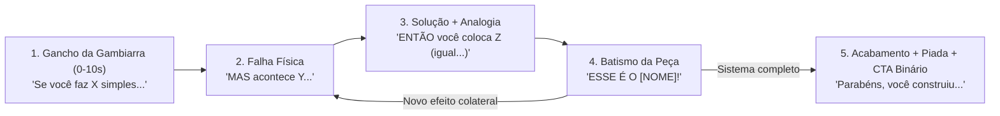

# Manual de Engenharia Reversa: Design, Lógica e Criativo `@desmontandoomundo`

Este documento consolida a análise quadro a quadro e palavra por palavra dos **3 Reels virais** baixados de `@desmontandoomundo` em `template/renders/`:

1. **Reel 1 — Como funciona o Ar-Condicionado (`DewJ1whAl3p`)**: `310.065 curtidas` • `1.517 comentários` • `141,9s` (`template/renders/ref_instagram.mp4`)
2. **Reel 2 — Como funciona um Telhado (`DezX76zgi47`)**: `1.748.442 curtidas` • `13.771 comentários` • `165,1s` (`template/renders/ref_reel_2_DezX76zgi47.mp4`)
3. **Reel 3 — Como um Arranha-Céu fica de pé (`De4oWvEh06y`)**: `885.869 curtidas` • `2.962 comentários` • `147,5s` (`template/renders/ref_reel_3_De4oWvEh06y.mp4`)

---

## 1. A Lógica Narrativa ("Engenharia Reversa por Gambiarra")

O segredo viral do canal **não é descrever um objeto pronto**. Ele **nunca** começa mostrando o ar-condicionado, o telhado ou o prédio prontos. Em vez disso, ele coloca o espectador na pele de alguém tentando resolver um problema do zero com uma **gambiarra ingênua**, mostra por que ela falha fisicamente, e **inventa cada peça da engenharia moderna ao vivo** para consertar o defeito da etapa anterior.

### O Algoritmo de Roteiro em 4 Fases

### Comparativo Estrutural dos 3 Vídeos Virais

| Etapa da Fórmula | Reel 1: Ar-Condicionado (`310k` likes) | Reel 2: Telhado (`1,75M` likes) | Reel 3: Arranha-Céu (`886k` likes) |
| :--- | :--- | :--- | :--- |
| **1. Gancho ("Se você...")** | *"Se você tá morrendo de calor e coloca um balde de gelo na frente do ventilador, sai um vento geladinho..."* | *"Se você levanta as paredes da casa e fecha em cima com uma laje reta de concreto..."* | *"Se você tirar o telhado da sua casa e empilhar um monte de andares em cima dela, vai ter uma catástrofe..."* |
| **2. Primeira Falha ("Mas...")** | *"...mas logo o gelo derrete e sobra um balde de água morna."* | *"...a chuva fica empoçada, acha uma rachadurinha e pinga lá dentro. Se inclinar a laje inteira, ela estica no sol e racha."* | *"...cada andar a mais pesa nos de baixo até o tijolo esmagar (precisaria de parede de 2m)."* |
| **3. Loop Recursivo (`Mas -> Então -> Esse é o...`)** | 1. **Fluido Refrigerante** (ferve a -50°C) 2. **Evaporador** (serpentina + ventilador) 3. **Compressor** (espreme gás a 70°C, *igual bomba de pneu*) 4. **Condensador** (serpentina externa) 5. **Válvula de Expansão** (furinho estreito) 6. **Dreno** (*igual copo gelado suando*) 7. **Termostato** (quarto vira geladeira a 16°C) 8. **Inverter** (gira devagar sem desligar) | 1. **Telhas** (peças pequenas e soltas) 2. **Inclinação 30%** (30cm a cada 1m) 3. **Ripas** (seguram as telhas) 4. **Caibros** (sustentam as ripas) 5. **Tesouras** (*triângulo não deforma* sob 3 toneladas) 6. **Cumieira** (fecha o topo) 7. **Beiral** e **Calha** (afastam água da parede) 8. **Rufo** (encontro com parede alta) 9. **Subcobertura** (manta de alumínio) 10. **Forro** (colchão de ar quente preso) | 1. **Pilares e Vigas** (esqueleto de concreto) 2. **Concreto Armado** (barras de aço no puxão) 3. **Estacas** (dezenas de metros até chão firme) 4. **Núcleo** (tubo central contra o vento + elevador) 5. **Amortecedor de Massa** (pêndulo no topo) 6. **Pele de Vidro** (leve, parede não segura peso) 7. **Impermeabilização** (manta elástica no topo) 8. **Andar Técnico** (caixa d'água e máquinas) |
| **4. Toque Final + Humor** | *"Coloque um filtro, uma tampa branca e um controle remoto."* | *"Amarra as telhas da beirada com arame pro vento não levar."* | *"Coloque uma portaria, um interfone e um vizinho que arrasta móveis à meia-noite."* |
| **5. Fechamento + CTA** | *"Parabéns, você construiu um ar-condicionado! Comente **FRIO** se você não sabia dessa."* | *"Parabéns, você construiu um telhado! Se sabia comente **ENGENHEIRO**, se não sabia comente **ESTAGIÁRIO**."* | *"Parabéns, você construiu um arranha-céu! Se sabia comente **CONSTRUTOR**, se não sabia comente **APRENDIZ**."* |

---

## 2. Regras de Ouro da Escrita do Roteiro

1. **Zero Jargão Antes da Função:** Nunca apresente uma peça pelo nome técnico. Primeiro mostre a dor (*"o líquido ainda tá espremido"*), depois a solução física simples (*"faz ele passar por um furinho estreito para cair num cano largo e se soltar"*), e **só no último segundo** batize: *"Essa é a válvula de expansão!"*.
2. **Conectores Obrigatórios de Ritmo:**
   - Transição de defeito: **`"Mas..."`** / **`"Só que..."`**
   - Transição de invenção: **`"Então você..."`** / **`"Por isso você..."`**
   - Batismo técnico: **`"Esse é o [X]"`** / **`"Essas são as [Y]"`**
3. **Analogias Físicas do Dia a Dia:**
   - Compressão adiabática $\rightarrow$ *"igual bomba de encher pneu"*
   - Condensação de umidade $\rightarrow$ *"igual um copo gelado suando"*
   - Treliça estrutural $\rightarrow$ *"triângulo é a forma que não deforma"*
   - Tração vs. Compressão $\rightarrow$ *"concreto aguenta aperto, mas não aguenta puxão"*
   - Isolamento térmico $\rightarrow$ *"colchão de ar preso lá em cima"*
4. **Densidade e Cadência:**
   - Ritmo de **~3,1 a 3,4 palavras por segundo** (~190 palavras/minuto), sem pausas mortas entre frases; cada `"Mas..."` já engata imediatamente um zoom ou rotação de câmera.

---

## 3. Design System 3D Low-Poly (`Three.js` / `Remotion`)

### 3.1. Geometria e Materiais
- **Estética Low-Poly Limpa (Flat/Standard Shaded):**
  - Árvores, nuvens e partículas de vapor/calor usam geometrias facetadas (`IcosahedronGeometry(r, 0)` ou `DodecahedronGeometry(r, 0)` com `flatShading: true`).
  - Paredes, pisos, vigas e móveis usam blocos chanfrados/limpos com `roughness: 0.55–0.75`, sem texturas fotográficas ruidosas — todo detalhe (tábuas do piso, tijolos, telhas, grades) é **geométrico**.
- **Tubulações e Fluxos Internos (Raio-X 3D):**
  - Quando há fluido ou força invisível, o objeto externo fica **semitransparente** (`opacity: 0.42–0.50`, cor cobre `#D97B38` ou vidro) e o interior mostra **esferas ou cápsulas 3D animadas** percorrendo uma curva `CatmullRomCurve3`.
- **Iluminação e Sombra:**
  - `PCFSoftShadowMap` ativado, `ACESFilmicToneMapping` (`exposure: 1.08`).
  - Luz solar direcional quente (`#FFFDF6`, intensidade `1.45`) projetando feixe de sol pela janela no chão de madeira + `HemisphereLight` (`#C8E8FF` céu / `#8A7356` solo).

### 3.2. Paleta de Cores Oficial (Extraída dos Frames)
| Elemento | Hex Principal | Hex Secundário / Borda | Aplicação |
| :--- | :---: | :---: | :--- |
| **Céu / Fundo Externo** | `#5BA4E5` | `#A9D6F5` (horizonte) | Gradiente limpo de céu diurno |
| **Grama / Árvores Low-Poly** | `#68B836` | `#2D8A22` / `#1E6B18` | Gramado e copas facetadas |
| **Parede Interna / Externa** | `#EADBC8` | `#C7AE91` / `#D8D8D4` | Sala aconchegante / fachada |
| **Piso de Tábuas** | `#C68B53` | `#9A6332` (frisos) | Tábuas corridas com juntas escuras |
| **Poltrona / Sofá** | `#008B68` | `#00684D` | Verde-esmeralda (Reel 1) ou Azul `#1E40AF` (Reel 2) |
| **Cobre (Serpentinas)** | `#D97B38` | `#A9541C` | Evaporador, condensador e tubos |
| **Frio / Gás Expandido / Água** | `#4CC9F0` | `#2563EB` | Bolinhas frias, gotas de dreno e vento gelado |
| **Calor / Gás Comprimido** | `#FF6B2B` | `#DC2626` | Octaedros de calor, gás a 70°C e setas de carga |
| **Título de Peça 3D** | `#FFE135` | `#111111` (contorno 3D) | Batismo de cada componente (`EVAPORADOR`, `TELHAS`) |
| **Pílula de Status (HUD)** | `#FFFFFF` | `#111111` (texto) | Badges flutuantes (`• +70 °C`, `• APERTADO`) |

---

## 4. Sistema de HUD 2.5D e Legendas Dinâmicas

1. **Rótulos Amarelos de Batismo (`3D Extruded Yellow Labels`):**
   - Aparecem exatamente quando o narrador diz *"Esse é o [NOME]"*.
   - Caixa alta, fonte ultra-bold (`Inter` / `Montserrat` 900), preenchimento amarelo `#FFE135`, contorno preto grosso + extrusão/sombra dura preta, levemente inclinados no espaço (`-2°` a `-4°`), com entrada elástica (`scale 0 -> 1.12 -> 1.0` em 10 frames).
2. **Pílulas Brancas de Estado (`Status Pills`):**
   - Fundo branco `#FFFFFF`, borda preta sutil, formato cápsula (`border-radius: 999px`), bolinha indicadora colorida à esquerda (`#EF4444` para quente/alerta, `#3B82F6` para frio/água, `#22C55E` para ligado/ok, `#F59E0B` para pressão/peso) + texto curto em caixa alta (`• QUARTO: 30 °C`, `• +70 °C`, `• ESPREMIDO`, `• SOLTO`, `• 16 °C`, `• 3 TONELADAS`).
3. **Setas 2.5D e Medidores Gráficos:**
   - **Seta Curva Tracejada Amarela:** Arco tracejado amarelo com contorno preto mostrando retorno de ciclo ou caminho do fluido.
   - **Setas de Força/Fluxo Vermelhas e Azuis:** Setas retas grossas com contorno preto indicando compressão/tração ou dissipação de calor.
   - **Velocímetro / Medidor (`VELOCIDADE`):** Card branco com borda preta, arco colorido (verde $\rightarrow$ amarelo $\rightarrow$ vermelho) e ponteiro animado para explicar o `INVERTER`.
4. **Legenda Palavra por Palavra com Destaque Automático (`Word-by-Word Pop Subtitle`):**
   - Posicionada a `~74%–78%` da altura da tela (`y ≈ 1420–1490` em `1080×1920`).
   - Exibe **1 palavra por vez** (ou 2 quando há artigo/preposição curtíssima ligada), sincronizada com a fala.
   - **Regra de Cor das Palavras:**
     - Palavras comuns: **Branco (`#FFFFFF`)** com contorno preto de `10px` e sombra dura.
     - Palavras-chave (nomes de peças, temperaturas, verbos físicos centrais): **Amarelo (`#FFE135`)** ou **Laranja (`#FFA800`)** com contorno preto!

## 8. Kit Permanente de Personagem Rigado e Plates Reutilizáveis (PROIBIDO Recriar do Zero!)

Para garantir consistência 1:1 com o canal `@desmontandoomundo` em qualquer novo vídeo (Geladeira, Telhado, Arranha-Céu, Motor, Avião, etc.), **nunca recrie o boneco, a poltrona ou o balde do zero**:

1. **Rig 3D Oficial Articulado (`template/src/shots/G1/DesmontandoRig.ts`)**:
   - `createDesmontandoCharacter()`: Retorna o boneco oficial com esqueleto FK conectado (`shoulder -> upperArm -> elbow -> forearm -> hand` e `hip -> thighShorts -> knee -> shin -> slipper`), cabelo alto esculpido com topete (`rotation.x = +0.14`, testa e sobrancelhas livres), olhos pretos brilhantes com reflexo branco (`catchlight`), bochechas rosadas, gotinha de suor e capacete de obra amarelo opcional (`charRig.hardHat.visible = true`).
   - Controle de pose instantâneo por frame:
     - `charRig.setPose('sitting_hot', N)` — Sentado na poltrona com calor, suor no pescoço e expressão triste.
     - `charRig.setPose('sitting_cool', N)` — Sentado na poltrona refrescado e sorrindo.
     - `charRig.setPose('standing_wave', N)` — Em pé acenando com os dois braços levantados (usado em Telhado e Arranha-Céu para escala humana).
     - `charRig.setPose('standing_neutral', N)` — Em pé neutro ao lado da máquina/construção.
   - `createBeveledArmchair()`: Poltrona verde chanfrada com `RoundedBoxGeometry` e pés de madeira.
   - `createRibbedIceBucket()`: Balde metálico cinza-taupe com 3 frisos horizontais em relevo (`TorusGeometry`), alça curva preta e monte piramidal de cubos de gelo low-poly.

2. **Plates e Sprites Originais Extraídos (`template/public/assets/desmontando_kit/CATALOG.json`)**:
   - `personagem_sentado_calor.png`, `personagem_sentado_com_balde.png`, `personagem_em_pe_acenando.png`, `personagem_em_pe_capacete_escala.png`, `balde_gelo_original.png`, `ventilador_pedestal_original.png` e plates completos das cenas de Sala, Telhado e Arranha-Céu.
